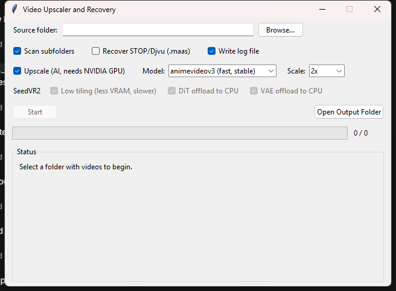

# Video Upscaler and Recovery

Standalone Windows app for **AI video upscaling**, with optional recovery
of **STOP/Djvu ransomware-encrypted (`.maas`) video files**.

- Upscaling engines: **Real-ESRGAN** (ncnn-vulkan, 2x/4x) and
  **SeedVR2** (3B / 7B, plus GGUF quantized variants for low-VRAM cards)
- Recovery: rebuilds playable MP4s from STOP/Djvu-encrypted video files
  (new variant, post-2019) without the attacker's key
- Single-folder app: `VideoUpscalerRecovery.exe` + `_internal\` +
  `seedvr2\` — copy the whole folder, no installer

<p align="center">
  
</p>

## Requirements

- Windows 10/11 (64-bit)
- NVIDIA GPU (CUDA / Vulkan) for upscaling — not needed for recovery
  alone. SeedVR2 7B wants ~12+ GB VRAM; the 3B and GGUF models fit less.

## Building on a fresh PC

Double-click **`setup_and_build.bat`**. It checks Python, installs
PyInstaller, downloads `ffmpeg\` and `esrgan\` (skipped when already
present), and builds the exe into `dist\VideoUpscalerRecovery\`.
Re-runnable at any time.

`build.bat` does just the build step (same temp-build + merge).

Output: `dist\VideoUpscalerRecovery\VideoUpscalerRecovery.exe`
(share the whole `dist\VideoUpscalerRecovery\` folder). The
build also copies `README_user.txt` into the folder — the
end-user guide.

Both scripts build into a temp folder and merge only the exe +
`_internal\` into `dist\` — PyInstaller wipes its target folder, which
would destroy a `seedvr2\` + `output\` already living there.

## SeedVR2 setup (on the machine that uses the app)

**SeedVR2** (optional, only for the seedvr2 models) is a ~24 GB
*runtime* dependency and is deliberately not part of the build:
double-click `setup_seedvr2.bat` **inside the shipped folder**
(`dist\VideoUpscalerRecovery\`). It creates `seedvr2\` with a Python
venv, the repo, runs `download_seedvr2_models.py`, and applies
`seedvr2_patch.py` (VRAM telemetry fix — see below).

Without `seedvr2\` the app still works — the SeedVR2 entries simply do
not appear in the model dropdown.

## Using the app

1. Pick a **source folder** (optionally scan subfolders).
2. Toggles:
   - **Recover STOP/Djvu (`.maas`)** (off by default) — include
     encrypted `.maas` files from the folder
   - **Upscale (AI, needs NVIDIA GPU)** (on by default) — pick a model
     and scale/target resolution
   - **Write log file** — appends to `recovery_log.txt` next to the exe
   - **SeedVR2** (all on by default) — low tiling, DiT offload
     to CPU, VAE offload to CPU; memory-safety options that only
     affect the SeedVR2 models (greyed out for the Real-ESRGAN models)
3. **Start** — disabled until there are processable files *and* at least
   one of Recovery / Upscale is on.

### What happens per file

| Input | Result |
|---|---|
| `.maas` (recovery on) | stream rebuilt in a temp dir, then converted to H.264 + AAC |
| `.mp4` with a legacy codec (MPEG-4 Part 2 / `mp4v`) | converted to H.264 + AAC |
| `.mp4` with any other codec (h264, h265, av1, vp9, ...) | copied as-is, no re-encode |
| Upscale on | AI-upscaled copy; the `recovered\` folder is **not** written — conversion happens silently in temp |

### Output layout

```
<exe folder>\output\
    _manifest.json          shared skip-state (MD5 of each source file)
    <source folder name>\
        recovered\          H.264 versions / copies (when upscaling is OFF)
        upscaled\           AI-upscaled versions (when upscaling is ON)
```

Existing outputs are never overwritten; reruns skip finished files via
the manifest (change the model/scale and only those get redone).

## STOP/Djvu background

This ransomware variant Salsa20-encrypts only the **first 153,600 bytes**
of a file (plus a 334-byte footer: RSA key id, 40-char Personal ID, and a
constant marker). Phones and cameras usually write the MP4 index (`moov`)
at the **end** of the file, so the media data survives intact and a
playable file can be rebuilt:

```
new ftyp header  +  intact media data  +  original index (offsets fixed)
```

The cost: the first ~1 second of the clip. `scan_stopdjvu.py` is a
standalone scanner that lists the encrypted files in a folder and
classifies each victim as OFFLINE (free decryption possible) or ONLINE
(key held only by the attacker) — for videos, recovery works either way
because only the header is destroyed.

## Files

| File | Purpose |
|---|---|
| `stopdjvu_gui.py` | Tkinter GUI (app entry point) |
| `README_user.txt` | end-user guide, copied into the shipped folder at build |
| `recover_stopdjvu_video.py` | engine: recovery, conversion, upscaling |
| `scan_stopdjvu.py` | standalone STOP/Djvu folder scanner (OFFLINE/ONLINE) |
| `VideoUpscalerRecovery.spec` | PyInstaller spec |
| `setup_and_build.bat` | fresh-PC one-shot: Python check, ffmpeg + esrgan download, build |
| `build.bat` | build only (temp build + merge into `dist\`) |
| `setup_seedvr2.bat` / `download_seedvr2_models.py` | SeedVR2 install (run in the shipped folder) |
| `seedvr2_patch.py` | patches the third-party SeedVR2 CLI so VRAM telemetry follows `--cuda_device` (applied by `setup_seedvr2.bat`) |

`ffmpeg\`, `esrgan\`, `seedvr2\` are downloaded at setup time (see
above); `dist\`, `output\`, `recovered\` and `recovery_log.txt` are
build/runtime artifacts.

## Third-party projects

This app is built on several open-source projects:

| Project | What it provides here | Link |
|---|---|---|
| SeedVR2 CLI (NumZ) | the diffusion upscaler backend - the `seedvr2\` CLI the app runs | [numz/ComfyUI-SeedVR2_VideoUpscaler](https://github.com/numz/ComfyUI-SeedVR2_VideoUpscaler) |
| SeedVR / SeedVR2 | the 3B/7B restoration model weights and the research behind SeedVR2 | [ByteDance-Seed/SeedVR](https://github.com/ByteDance-Seed/SeedVR) |
| Real-ESRGAN (ncnn-vulkan) | the fast 2x/4x upscaler binary in the `esrgan\` folder | [xinntao/Real-ESRGAN-ncnn-vulkan](https://github.com/xinntao/Real-ESRGAN-ncnn-vulkan) |
| Real-ESRGAN | the underlying image-restoration algorithm | [xinntao/Real-ESRGAN](https://github.com/xinntao/Real-ESRGAN) |
| FFmpeg | video decode / re-encode / mux in the `ffmpeg\` folder | [ffmpeg.org](https://ffmpeg.org) |
| PyInstaller | packages the app into the standalone exe | [pyinstaller/pyinstaller](https://github.com/pyinstaller/pyinstaller) |
| uv | creates the SeedVR2 Python venv (used by `setup_seedvr2.bat`) | [astral-sh/uv](https://github.com/astral-sh/uv) |
| ncnn | the inference engine inside Real-ESRGAN-ncnn-vulkan | [Tencent/ncnn](https://github.com/Tencent/ncnn) |

Each is used under its own open-source license.

## Notes

- The log file is always named `recovery_log.txt` (next to the exe).
- Closing the app mid-run kills all child processes (ffmpeg, Real-ESRGAN,
  SeedVR2 python) so nothing keeps burning GPU in the background.
- The SeedVR2 model dropdown auto-detects the `seedvr2\` folder; a
  missing folder just hides those models.
